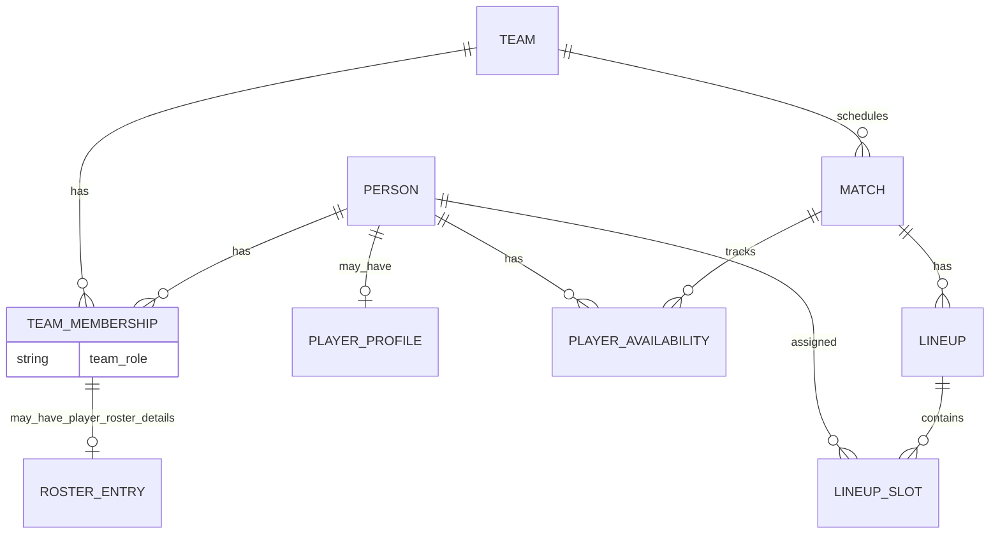

# Domain Model

## Status

Active. This document is the current domain-model baseline using the vocabulary accepted in [ADR 0006](../adr/0006-represented-person-identity-api-contract.md). Infrastructure persists `Person` in `People`; memberships and profiles reference `PersonId`. Applied migrations retain their original vocabulary.

## Purpose

This document defines the initial SquadSync domain model. The model is intentionally soccer-specific so the first implementation remains understandable, testable, and useful for the coach workflow.

## Modeling Strategy

The MVP uses explicit domain relationships:

```text
A represented Person participates in a Team through a TeamMembership.
The TeamMembership carries one constrained TeamRole.
```

`Person` represents a person in SquadSync's domain. It is distinct from a future authentication account or external login identity. Authentication/account identity remains a future concern. The future access model may allow one account to act for more than one represented person, for example a parent or guardian acting for a youth player. This possibility does not define or implement account linking or delegation behavior in the MVP.

## Core Concepts

### Person

A represented person in the domain, such as a coach, assistant coach, team manager, or player. A person's participation in each team is modeled by a separate `TeamMembership`.

`Person` is not an authentication account. Account identity and authentication are deferred; an account may eventually be associated with or act for multiple represented people.

### Team

A soccer team managed in SquadSync. A team has memberships; player memberships may carry roster entries. A team also owns matches and lineups.

### TeamMembership

The relationship between a `Person` and a `Team`. It records the person's team participation and has exactly one `TeamRole` in the MVP. A person may have memberships on multiple teams and may have different roles on each.

### TeamRole

A constrained MVP value on `TeamMembership`. Its allowed values are exactly `Owner`, `Coach`, `AssistantCoach`, `Manager`, `Player`, and `Viewer`; undefined values are invalid. It is not a persisted, dynamically configurable Role/Permission entity model. Keep authorization simple; introduce more granular permissions only when concrete product behavior requires them and an approved design defines them.

### PlayerProfile

Person-level soccer attributes associated with a `Person`: optional dominant foot, height in total inches, and weight in pounds. Preferred positions are deferred until the soccer-position/formation/lineup vocabulary is defined. It does not own team-context data such as jersey number or roster status, or match-specific availability.

### RosterEntry

The player-only team-context record attached to a player's `TeamMembership`. The membership remains the canonical relationship between the represented `Person` and `Team`; `RosterEntry` adds roster details such as jersey number and roster status to that player membership and does not create a second `Person`-to-`Team` relationship. It is distinct from person-level `PlayerProfile` attributes.

### CoachProfile

Deferred. A dedicated coach profile is not needed for the initial model; add it only if a concrete MVP use case requires coaching-specific person attributes.

### Statistics

Deferred to later dedicated models. Do not add statistics fields to `PlayerProfile` or `RosterEntry` as a shortcut.

### Match

A scheduled soccer match for a team. Potential fields include opponent name, scheduled date/time, location, status, and notes.

### Formation

A named soccer formation used for lineup planning, such as 4-3-3, 4-4-2, or 3-5-2. The first MVP may store formations as controlled values before introducing a configurable formation model.

### Lineup

A lineup plan for a match. A lineup belongs to a match and contains lineup slots.

### LineupSlot

A specific assignment within a lineup, including position and assigned player. Period/segment and notes may be added when needed.

### PlayerAvailability

A player's availability for a match, with values such as Available, Unavailable, Injured, Late, or Unknown.

## Initial Relationship Diagram



The diagram shows domain relationships, not authentication-account relationships. `TeamMembership` is the only `Person`-to-`Team` relationship. `RosterEntry` is optional player-specific detail attached to that membership. `TeamRole` is a constrained value carried by membership, not a separately managed role catalog.

## Suggested Initial Entities and Values

```text
Person
Team
TeamMembership (with one TeamRole value)
PlayerProfile
RosterEntry
Match
PlayerAvailability
Formation
Lineup
LineupSlot
```

`CoachProfile`, statistics models, and authentication/account models are deferred. `TeamRole` is a constrained value and does not imply a persisted `Role` entity.

## Soccer Position Modeling

Preferred positions are excluded from the Sprint 5 `PlayerProfile` contract. Define the soccer-position/formation/lineup vocabulary in a later slice before adding preferred positions; do not use JSON or string position shortcuts in the interim.

The MVP can begin with a simple position enum or value object.

Examples:

- GK
- CB
- LB
- RB
- CDM
- CM
- CAM
- LW
- RW
- ST

Do not overbuild the position model early. Formation-specific slot modeling can evolve after manual lineup building works.

## Membership, Roster, and Profile

Use these distinctions:

- `Person`: represented person, separate from future authentication/account identity
- `TeamMembership`: the person's team relationship and one constrained `TeamRole`
- `PlayerProfile`: soccer attributes about the person
- `RosterEntry`: player-only team-context data attached to a `TeamMembership`, including jersey number and roster status

A person may be a player on one team and an assistant coach on another. Represent that with one `Person` and separate memberships. A player's roster entry extends the player membership with team-specific data; it does not create another `Person`-to-`Team` relationship or turn `PlayerProfile` into team data.

## Current Membership Implementation Contract

The current shape retains the Sprint 4 relationship with the vocabulary accepted in [ADR 0006](../adr/0006-represented-person-identity-api-contract.md):

```text
TeamMembership
- Id: Guid
- PersonId: Guid
- TeamId: Guid
- TeamRole: TeamRole
```

### Domain Invariants

- A represented `Person` may belong to many `Teams`; a `Team` may have many memberships.
- A `Person` may have at most one `TeamMembership` for the same `Team`.
- Each membership has exactly one `TeamRole`, from the six allowed values above.
- `Id`, `PersonId`, and `TeamId` are application-assigned and must not be `Guid.Empty`.
- Undefined `TeamRole` values are invalid.
- Domain represents the relationship using `PersonId` and `TeamId` identifiers and remains EF-independent; it does not require EF navigation properties or persistence annotations.
- `TeamMembership` owns no roster-only or authentication/account fields.

### Infrastructure Mapping Direction

Under [ADR 0003](../adr/0003-use-explicit-membership-model.md) and [ADR 0005](../adr/0005-ef-core-npgsql-persistence.md), Infrastructure owns the EF Core mapping and migration:

- Foreign keys from `TeamMembership.PersonId` to `Person` and from `TeamMembership.TeamId` to `Team` enforce endpoint existence.
- Both relationships use restrictive/no-cascade deletion semantics: deleting a referenced `Person` or `Team` must not implicitly delete memberships.
- A unique constraint or unique index on `(PersonId, TeamId)` enforces one membership per pair across persisted records.
- `TeamRole` is persisted as a readable string value; there is no separate `Role` table.
- No repository abstraction is introduced in Phase 2 merely because `TeamMembership` exists. Application persistence contracts wait for concrete use cases, as required by ADR 0005.

### Deferred Concerns

Authentication/account identity and delegation, membership status, joined/left timestamps, granular permissions, a dynamic `Role` entity, HTTP endpoints, generic repository/base entity work, auditing, and soft deletion remain deferred. `RosterEntry` extends a player membership; it does not add another `Person`-to-`Team` relationship.

#### Future stewardship and verified identity claims

A Team staff member may create a represented `Person` before that person or a guardian has an account. For example, a coach adds a youth player; later, an authorized guardian verifies a claim and becomes responsible for the player's person-level details and `PlayerProfile`. The coach's separately authorized Team duties may still include roster status or jersey number, but do not imply ongoing control of the person's own data.

The future design must resolve claim verification, account/guardian delegation, duplicates and disputed identity matches without automatic merges. **This is a deferred design direction, not an implemented MVP permission or claim process.** Revisit before authenticated Person/Profile editing or account claims. See [#199](https://github.com/bbubb/squadsync/issues/199) for the separate Add Player lookup gate.

## Provisional identity, roster departures and data lifecycle — Phase 4 direction

**Status:** Approved product-boundary direction for [Sprint 12](https://github.com/bbubb/squadsync/issues/207) and [Sprint 13](https://github.com/bbubb/squadsync/issues/208); **not an implemented API, database deletion policy, authorization rule or approved membership-termination schema**. Existing [ADR 0006](../adr/0006-represented-person-identity-api-contract.md) remains authoritative for represented Person versus Account.

### Provisioning and authority

A coach may provision a `Person` to roster a player before that person or their guardian has an Account. This does not prove the Person is new or confer permanent authority over that person's identity. The trusted-local Development UI may allow provisional PlayerProfile edits; later authenticated claims, verified guardian delegation and ownership/stewardship transitions need their own authorization policy. Team-level authority over jersey number, roster status or TeamMembership must not automatically grant unrestricted control of Person-level information. A supplied GUID, display name, team role or invitation link is not identity proof.

A **future** invitation/acceptance workflow must distinguish inviting someone to participate from granting them control of an existing Person; access/claim verification and revocation are deferred. See [discovery and identity gate #199](https://github.com/bbubb/squadsync/issues/199) before adding a production search or claim mechanism.

### Team participation and removal

- **Roster removal is not Person deletion:** The ability to remove a player's active RosterEntry is a Sprint 13 completion objective; preserve the reusable represented Person and optional Person-level PlayerProfile.
- **TeamMembership lifecycle is distinct:** Define what ending TeamMembership means and how dependent RosterEntries are handled **before** implementing membership removal. Current restrictive foreign keys do not permit assuming broad cascade deletion. A later match/history model may require retained participation records; do not pre-select a soft-delete framework or claim current statuses encode departure.
- **Multi-Team participation is ordinary:** Adding an existing Person to another Team creates a separate destination TeamMembership and, for players, destination RosterEntry. It does not move or duplicate their shared PlayerProfile, silently revoke source-Team relationships or prove an official competitive transfer.
- **Official competition eligibility/transfer** may require governing-body approval and registration release distinct from SquadSync's basic Team roster edit; revisit when competition-registration workflows are designed.
- **Data erasure and historical retention:** Person/Profile removal, user privacy requests, audit/provenance and event/history preservation require a separately reviewed lifecycle and applicable legal/authorization rules before production or permanent deletion endpoints. No global delete authorization is implied by Dev-only management APIs.

**Revisit gates:** Review exact roster-entry removal/re-add behavior and associated persistence/HTTP semantics in Sprint 13 before coding; review membership termination before its own issue; revisit retained match history before Phase 5 depends on roster history; revisit verified stewardship, public discoverability and Person-level erasure before authenticated/public use. Link decisions to the canonical Domain/HTTP contract or ADR rather than creating a parallel design log.

## Current Player Profile and Roster Implementation Contract

The accepted contract under [Sprint 5 tracker #102](https://github.com/bbubb/squadsync/issues/102) and [architecture gate #103](https://github.com/bbubb/squadsync/issues/103) separates person-level soccer attributes, team-context roster data, and match availability.

### PlayerProfile

The minimal persisted shape is exactly:

```text
PlayerProfile
- Id: Guid
- PersonId: Guid
- DominantFoot: DominantFoot?
- HeightInches: int?
- WeightPounds: decimal?
```

- A `Person` may have at most one optional `PlayerProfile`.
- `Id` and `PersonId` are application-assigned and must not be `Guid.Empty`.
- `DominantFoot`, when supplied, must be exactly `Left`, `Right`, or `Both`; undefined values are invalid. This represents foot dominance, not a player's preferred field side or flank.
- Optional height and weight values, when supplied, must be greater than zero.
- `HeightInches` stores total inches as an integer (for example, 5 ft 10 in = 70); `WeightPounds` stores pounds as a decimal.
- These are the canonical MVP storage units for the initial US-first product context. Do not persist duplicate imperial and metric copies of the same measurement or introduce ambiguous `Height` or `Weight` fields.
- Later measurement-system support should convert at the API/UI boundary so users can enter/view feet+inches/pounds or centimeters/kilograms without creating two competing sources of truth. Implementing conversion is outside this slice.
- Preferred positions remain deferred until the soccer-position/formation/lineup vocabulary is defined; do not store JSON or string position shortcuts.
- `PlayerProfile` owns no jersey number, roster status, match availability, team assignment, statistics, or authentication fields.

### RosterEntry

The minimal persisted shape is exactly:

```text
RosterEntry
- Id: Guid
- TeamMembershipId: Guid
- JerseyNumber: string?
- RosterStatus: RosterStatus
```

- A `TeamMembership` may have at most one optional `RosterEntry`.
- `Id` and `TeamMembershipId` are application-assigned and must not be `Guid.Empty`.
- Do not duplicate `PersonId` or `TeamId`; `TeamMembership` remains the only `Person`-to-`Team` relationship.
- `JerseyNumber` is an optional label containing 1–3 ASCII digits when supplied. Preserve legitimate formatting such as `00`. Whitespace is not meaningful and must not be persisted.
- `RosterStatus` must be exactly `Active`, `Reserved`, or `Suspended`; undefined values are invalid.
- Career/person-level states such as `Retired` do not belong in `RosterStatus`.
- Match-specific states such as `Available`, `Unavailable`, `Injured`, and `Late` belong to match availability in Match context, not `RosterEntry`.

### Persistence and Enforcement Boundary

Following [ADR 0003](../adr/0003-use-explicit-membership-model.md) and [ADR 0005](../adr/0005-ef-core-npgsql-persistence.md), Domain remains EF-independent and Infrastructure owns explicit one-to-one mappings and migrations:

- `PlayerProfile.PersonId` is a foreign key to `Person` with a unique constraint or unique index, enforcing one optional profile per person.
- `RosterEntry.TeamMembershipId` is a foreign key to `TeamMembership` with a unique constraint or unique index, enforcing one optional roster entry per membership.
- Both relationships use restrictive/no-cascade deletion: deleting a referenced `Person` or `TeamMembership` must not implicitly delete its profile or roster entry.
- PostgreSQL enforces these structural foreign-key and uniqueness rules.

Player-role eligibility is a business/use-case invariant: only a membership whose `TeamRole` is `Player` may receive a `RosterEntry`. The Application `AddPlayerToRoster` use case loads the membership and validates its role before creating the roster entry. Do not create a cross-table database constraint for role eligibility. Phase 2 persistence tests may prove structural persistence independently; Application unit and PostgreSQL use-case tests prove Player-role eligibility.

### Deferred Concerns

Statistics, `CoachProfile`, authentication/account work, match availability, and formation/lineup implementation remain deferred. HTTP CRUD remains deferred. Application owns the concrete `IRosterPersistence` contract for `AddPlayerToRoster`; Infrastructure implements it. No generic repository is introduced.

## Integration Boundary Concepts

### LineupSuggestionRequest

A contract that packages enough match, roster, formation, and constraint data for an external service to suggest a lineup.

### LineupSuggestionResponse

A response containing suggested player-slot assignments and a high-level planning summary.

The request and response belong to the platform integration boundary. The algorithm/service implementation belongs to the separate lineup assistance service.

## Design Principle

The model should be understandable to a soccer coach, a software engineer, and a hiring reviewer. If a concept requires a long explanation, it probably does not belong in the first MVP.
